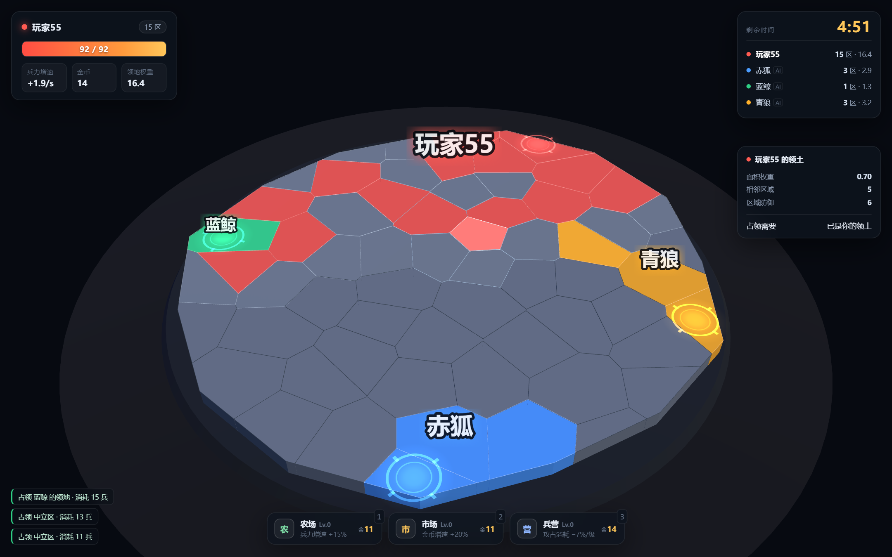
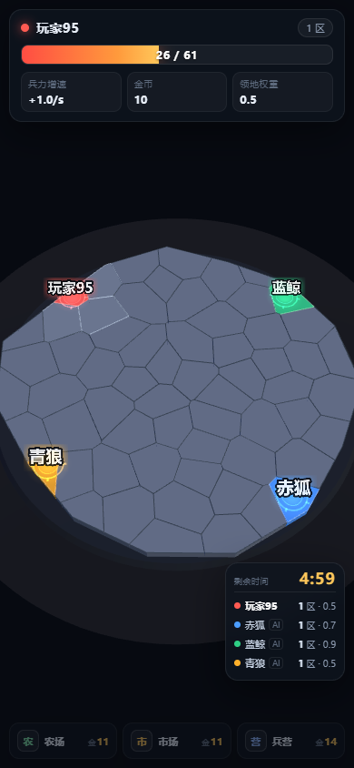

# 抢地盘 · 3D 区域争夺

[](https://github.com/diudiu666/game/actions/workflows/ci.yml)
[](LICENSE)
[](package.json)
[](CONTRIBUTING.md)

一个能直接在浏览器里开打的领土争夺游戏：**Voronoi 切图 + Three.js 渲染 + 服务端权威联机，最多 4 人同房，人不够 AI 补位。** 没有构建步骤，没有数据库，`npm install && npm start` 就能玩。



> **English** — A 3D territory-conquest game for up to 4 players. Voronoi-sliced board, Three.js rendering, server-authoritative Node.js + WebSocket backend, no build step and no database. Run `npm install && npm start` and open http://localhost:5173. Documentation is in Chinese; issues and pull requests in English are welcome.

## 它特别在哪

- **只按面积算账。** 占领消耗只看这块地多大，不看守方兵力、不掷骰子。同样的地，谁先算清成本谁占优——胜负在决策，不在手速。
- **兵力是持续消耗的。** 兵不是攒出来的，是每分钟被领地吃掉的。地盘越大产出越高，但想扩张就得一直算「这几块地值不值」。
- **都城 = 命门。** 每人开局一块都城（地面上有双层光环），守备 ×1.8；被攻破的人当场出局、全部领地回中立。所以中后期有明确的「斩首」窗口，而不是磨到时间结束比大小。
- **服务端权威。** 客户端只发「打哪块 / 买什么」两条指令，邻接判定、兵力扣除、淘汰计时全在 Node 端算。改前端代码抢不了地。

## 跑起来

需要 **Node.js 18+**（CI 用 22，见 `.nvmrc`）。不需要打包器、不需要数据库。

```bash
git clone https://github.com/diudiu666/game.git
cd game
npm install
npm start
```

打开 <http://localhost:5173>，点「单人练习」立刻开局；想联机就把地址（或页面里的「复制邀请链接」）发给朋友，手机打开也能进同一间房。

```bash
npm start                     # 正式服，5 分钟一局
TD_DURATION=30 npm start      # 调试用：把一局压到 30 秒
node serve.mjs                # 只跑静态资源（默认 5174，无联机，客户端自动退到单机）
```

**端口固定 5173。** 代码里写死了 `DEFAULT_PORT = 5173`，系统里的通用 `PORT` 变量刻意不生效（免得别的工具随手 `export PORT` 把正式服顶走）。确实要换端口只有这两种显式写法：

```bash
node server/index.mjs 5180      # 或
TD_PORT=5180 node server/index.mjs
```

非默认端口会在启动日志里打一行提醒。5173 被占时不会抛栈溢出，而是直接告诉你端口被谁占着、怎么清掉。

## 操作

| 操作 | 说明 |
| --- | --- |
| 左键点区域 | 出兵占领，前提是与己方领土接壤 |
| 拖动 / 滚轮 | 旋转视角 / 缩放 |
| `1` `2` `3` | 买农场 / 市场 / 兵营 |
| `Enter` | 大厅里等于点「开始对局」 |

手机上单指拖动旋转，点按占领：



## 规则

- 兵力、金币按「领土总权重」自动增长；地盘越大涨得越快。上限只作为防囤兵的安全阀，实测整局几乎不会触发。
- 地图是平的，没有高低差；占领消耗只看区域大小：`ceil(8.6 × 面积权重 × 1.1 + 2)`，中立区和敌区同一套，不吃守方加成。
- **都城**：每人开局那一块地就是都城（双层光环 + 旋转刻度，面板里标「都城」）。守备 ×1.8，被攻破的人**当场出局、全部领地回中立**。
- **战损**：打掉别人的地时，对方全局兵力池额外损失「本次花费 × 1.0」；打中立区不产生战损。
- 金币买三种全局加成，不占区域、不选址，价格 `11 / 11 / 14 × 1.42^等级`；兵营的主效果是攻占消耗 −7%/级（最低打到 50%）。
- 消灭全部对手（最后一个都城被攻破即算），或 5 分钟后领土权重最高者获胜。联机时真人出局可以继续观战到本局结束。

## 联机怎么设计的

客户端只发 `attack{id}` / `upgrade{type}` 两种指令，所有结算都在 Node 端做——邻接判定、兵力扣除、淘汰、计时、胜负全在服务端。

- **房间**：4 位邀请码（去掉 I/L/O/0/1 这些易混字符），带 `?room=CODE` 打开即入房。没有码就快速匹配一个还在等人的房间，都没有就新开一间。
- **开局**：房主点开始 → 3 秒倒计时（这时牌面已经摆好，所有人能看到自己分到哪块）。空位按座位顺序补 AI。
- **同步**：服务端 20Hz 跑逻辑，10Hz 广播快照；有事件（占领 / 淘汰）时立刻补一帧。快照只发 `owners[]`（62 个整数）+ 四个玩家的数值，约 1KB/帧。
- **断线重连**：token 存在 localStorage，刷新 / 断网回来后自动续回原座位；掉线超过 8 秒由 AI 托管，人一回来立刻收回控制权。
- **观战**：房间满员后进来的人自动变观战，一局结束自动补进座位。
- **防刷**：攻击 90ms 冷却 + 每秒 8 次的令牌桶，两端都限制。

## 地图上的名牌

每位玩家一个名字，挂在自己地盘上（按面积权重算质心，再吸附到最近的自家区域，防止飞地把名字挂到别人地里）。
字号跟着地盘走：`17 + 6.8 × √权重` 像素（上限 78px），62 格全吃满约 78px，1 格约 24px；字号按相机距离折算回世界单位，
所以缩放时字不会跟着涨到遮住半张地图。贴边的地盘会被推进屏幕安全区，避免在手机竖屏上被切掉一半。
平时不透明度 0.86，**指针压到名牌上时淡到 0.08**，让出底下的格子（否则大地盘的名字会盖住一片地，
既看不见归属也看不见悬停高亮，看起来像「点不到」）。

## 代码结构

```
index.html             HUD / 大厅 / 结算结构与样式（含手机竖屏）
src/game.js            全部规则与数值（CONFIG 在最上面）—— 客户端和服务端共用
src/mapgen.js          Voronoi 预切区域 → 相当于文档 §8 的 regions.json 生成器
src/world3d.js         Three.js 场景、区域网格、拾取、粒子
src/net.js             WebSocket 客户端（自动重连 + 心跳）
src/ui.js              HUD / 大厅 / 倒计时 / 结算
src/main.js            胶水层：本地单机 or 联机快照，两条路共用渲染
server/index.mjs       权威服务端：静态资源 + 房间 + tick + 广播
serve.mjs              纯静态服务器（无联机）
tools/lib/harness.mjs  浏览器验收脚本的公共启动器（跨平台找 Chromium）
tools/                32 个诊断 / 验收脚本，清单见 CONTRIBUTING.md
docs/                 README 用的截图（tools/hero.mjs 可重新生成）
```

`src/game.js` 不依赖 DOM，浏览器和 Node 各跑一份：联机时服务端跑权威版本，客户端只拿它算「这块地我现在打不打得动」用于高亮，不参与结算。**这条是硬约束**——它让所有规则都能被 `node` 直接跑断言，也是 `tools/` 里那些无头扫描能存在的原因。

## 关键数值

全部集中在 `src/game.js` 的 `CONFIG`：

| 项 | 值 |
| --- | --- |
| 开局兵力 / 金币 | 26 / 10 |
| 基础增速 | 兵 1.0/s，金 0.38/s |
| 基础兵力上限 | 60 |
| 权重系数 | 兵 0.055，金 0.03，上限 2.0/权重 |
| 农场 / 市场 / 兵营 | +15% 增速 / +30% 增速 / 攻占消耗 −7%·上限 +12 |
| 区域防御 | 8.6 × 面积权重（都城再 × 1.8） |
| 攻占消耗 | ceil((防御 × 1.1 + 2) × 兵营折扣)，折扣最低 50% |
| 战损 | 守方兵力 −= 本次花费 × 1.0（仅敌方区域） |
| 都城 | 开局起始区；被攻破即出局，全部领地回中立 |
| 对局时长 | 300 秒 |

> 兵营为什么不是「+上限」：实测玩家兵力常年在 6~27 之间徘徊（「够兵就立刻出兵」永远是最优解），
> 上限只要超过一次攻占的量级就永不触发（`tools/capstudy.mjs`：贴上限时间 0.0%、产出浪费 0.0%）。
> 所以上限被降级为「防止无限囤兵」的安全阀，兵营的价值改挂在「同样的地更省兵」上——这也是「兵力是持续消耗的」这个玩法里唯一能被玩家感知的收益。

### 都城为什么要「回中立」而不是归攻方

`tools/capsweep.mjs` 的对照：只有战损、没有都城时，24 局全部走到 300 秒超时，终局四家领地是 13/14/15/16——**谁也吃不掉谁**，只能靠时间到判权重。加都城后：

| 都城守备 | 淘汰局占比 | 平均时长 | 首次斩首 |
| --- | --- | --- | --- |
| 2.2 | 0% | 300s | 从不发生（AI 算下来不如刷普通地） |
| 1.8 | **71%** | 252s | 平均 139s（最早 73s） |
| 1.5 | 90% | 216s | 平均 93s（最早 36s，太早） |

1.8 是「终盘决胜负」的位置。被斩首者的领地**回中立**而不是归攻方，是为了不让一次斩首直接把攻方喂成不可追的领先——代价是终局地图会重新空出一片（平均剩 36 格中立），算是给剩下的人一次重新洗牌。

服务端的节奏参数在 `server/index.mjs` 顶部：`TICK_MS=50`、`SNAP_EVERY=2`、`COUNTDOWN_SEC=3`、`DISCONNECT_GRACE=8000`。

调试：`window.__game.state` 看局面，`window.__game.send({t:'attack', id:0})` 直接发指令。

## 协议速查

| 方向 | 消息 |
| --- | --- |
| C→S | `hello{name,token}` `join{code}` `start` `again` `rename{name}` `attack{id}` `upgrade{type}` `ping` |
| S→C | `hello{id}` `welcome{token}` `room{...}` `countdown{sec}` `start{map,players,you,preview}` `state{owners,players,events}` `cmd{ok,reason}` `pong` |

## 开发与测试

规则层是纯函数，绝大多数验证不需要开浏览器：

```bash
npm test                              # 连通性 + 都城断言 + 无头对局（秒级）
node tools/nettest.mjs                # 联机协议（要先 npm start）
node tools/pickcheck.mjs              # 浏览器验收：62 块地能不能点中自己
node tools/hero.mjs                   # 重新生成 README 头图
```

完整的脚本清单、浏览器环境怎么配、提交约定，都在 [CONTRIBUTING.md](CONTRIBUTING.md)。

## 已验证

- 协议层：进房 / 房主开局 / 非房主被拒 / 双端归属一致 / 不接壤目标被拒 / 断线续座（`node tools/nettest.mjs`）。
- 浏览器多人：2 / 3 / 4 人同房互抢，另一端 300ms 内看到归属变化；刷新页面能续回原座位。
- 房间流程：3 人开局 + 中途来第 4 人观战 → 结算回大厅 → 第 4 人补位 → 第二局 4 个真人。
- 整局流程：倒计时 → 25 秒对局 → 结算名次 → 回到房间 → 第二局计时重置。
- 手机 390×844：大厅不溢出、地图完整、触摸占领生效；桌面端 HUD 不遮挡。
- 都城规则：`node tools/capital.mjs` 28 项断言全过；`tools/capital-sim.mjs` 24 局全 AI 对局里斩首平均发生在 139 秒。
- 发育路线价值：`tools/upgradevalue.mjs` 四条路线同图对照（40 局平均权重），只买农场 10.0 / 只买兵营 11.6 / 按性价比混买 11.1 / 只买市场 4.9（市场是「加速器」，单买必输，属于预期）。兵营不再是无效项，三选一都有说法。
- 地图名牌：`tools/nameplates.mjs` 每位玩家一个名字落在自家地盘上，权重 1 → 30 字号从 4.2 长到 9.4（世界单位），手机 390×844 上四个名字全部完整在屏内。

## 与初版文档的差异

1. **地图改用算法生成**。原文档要求 Blender 手工切图再导 `regions.json`；这里用 Voronoi 图在运行时切分，邻接表和面积权重同一次算好。数据结构与文档一致，换成手工地图只要替换 `generateRegions()` 的返回值（服务端换完客户端不用改）。
2. **战斗去掉随机数**。占领 = 一次性派兵对拼区域防御（只看面积大小），不掷骰子。手感可预期，也不用为了公平去同步随机数。
3. **空位补 AI**。文档只规划了 2–4 人，实际很难凑满，所以 1 个人也能开局，剩下用 AI 补。
4. **没做增量同步的猜测 / 回滚**。快照 100ms 一帧、体积很小，直接全量下发；本地只做时钟插值，不做位置预测——这游戏没有实时动作，不需要。

## 参与贡献

欢迎 issue 和 PR。**最有用的贡献其实是试玩反馈和数值论证**——这个仓库里每个数值改动都是先用 `tools/` 跑出对照才进主干的。

- 玩法 / 数值建议请附一条能跑的命令和它的输出（见 [issue 模板](.github/ISSUE_TEMPLATE/feature_request.yml)）。
- 提交代码前请读 [CONTRIBUTING.md](CONTRIBUTING.md) 里那四条约定，尤其是「结算只在服务端」和「`src/game.js` 不许依赖 DOM」。
- 安全问题请按 [SECURITY.md](SECURITY.md) 私下报告，不要开公开 issue。
- 参与即表示同意遵守 [CODE_OF_CONDUCT.md](CODE_OF_CONDUCT.md)。

## 许可证

[MIT](LICENSE)。依赖的 [three.js](https://github.com/mrdoob/three.js) 与 [ws](https://github.com/websockets/ws) 也都是 MIT。
